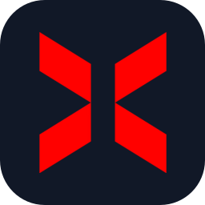

<div align="center">


<a href="https://dario.warkcorp.com">
  
</a>

<br/><br/>

<a href="https://dario.warkcorp.com"></a>
<a href="mailto:dario@xerohost.net"></a>
<a href="https://x.com/darioarto"></a>
<a href="https://www.instagram.com/darioarto_/"></a>

</div>

<br/>

<table>
<tr>
<td width="50%" valign="top">

#### `$ cat whoami.yml`

```yaml
name: Darío Arto
role: SysAdmin & Developer
based_in: Spain (Europe/Madrid)
focus:
  - Systems & network administration
  - VPS & game server hosting
  - Online communities
studying: Microcomputer Systems & Networks
off_hours: Curator @ Musixmatch
```

</td>
<td width="50%" valign="top">

#### `$ cat now.json`

```json
{
  "working_at": ["XeroHost", "Wark Corp."],
  "building": ["Vynk Social", "CosmixMC"],
  "learning": "Advanced networking",
  "status": "open to collaborations"
}
```

</td>
</tr>
</table>

### `$ ls ~/projects`

<table>
<tr>
<td width="50%" align="center" valign="top">
<br/>
<a href="https://xerohost.net"></a>
<h4><a href="https://xerohost.net">XeroHost</a></h4>
<code>COO & SysAdmin</code><br/><sub>2025 — Present</sub>
<p>VPS & game server hosting, part of XeroGroup LLC (AS216102), with infrastructure in Miami, Dallas and São Paulo.</p>
</td>
<td width="50%" align="center" valign="top">
<br/>
<a href="https://warkcorp.com"></a>
<h4><a href="https://warkcorp.com">Wark Corp.</a></h4>
<code>Founder & CEO</code><br/><sub>2023 — Present</sub>
<p>Moderation and security apps for Discord, Wark and WarkGuard, used on 160+ servers.</p>
</td>
</tr>
<tr>
<td width="50%" align="center" valign="top">
<br/>
<a href="https://discord.cosmixmc.net"></a>
<h4><a href="https://discord.cosmixmc.net">CosmixMC Network</a></h4>
<code>Founder, Owner & Lead Developer</code><br/><sub>2023 — Present</sub>
<p>Minecraft network I founded in 2023 and have led ever since as owner and lead developer.</p>
</td>
<td width="50%" align="center" valign="top">
<br/>

<h4>Vynk Social</h4>
<code>Founder & Developer</code><br/><sub>2026 — Present</sub>
<p>A new social network in development under Wark Corp.</p>
</td>
</tr>
</table>

### `$ ls ~/stack`

<p align="center">
  <sub><b>INFRASTRUCTURE</b></sub><br/><br/>
  
  <br/><br/>
  
  
  
  
  
  
</p>

<p align="center">
  <sub><b>DEVELOPMENT</b></sub><br/><br/>
  
</p>

### `$ git log --stats`

<div align="center">
  
  
</div>

<br/>


